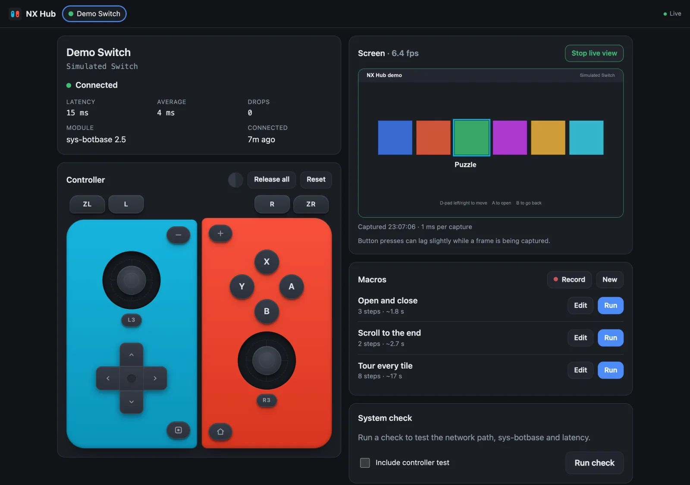
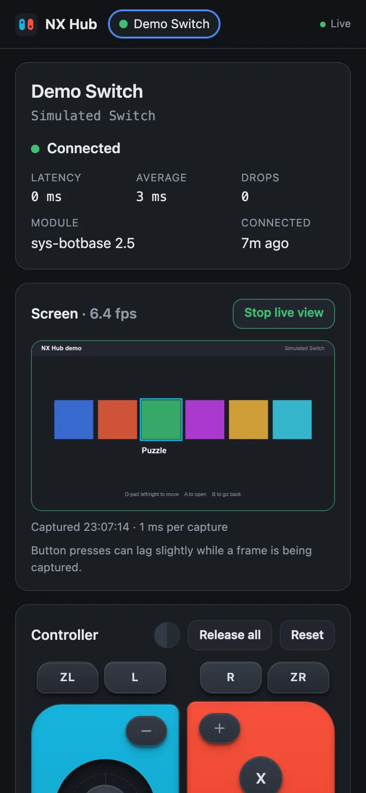
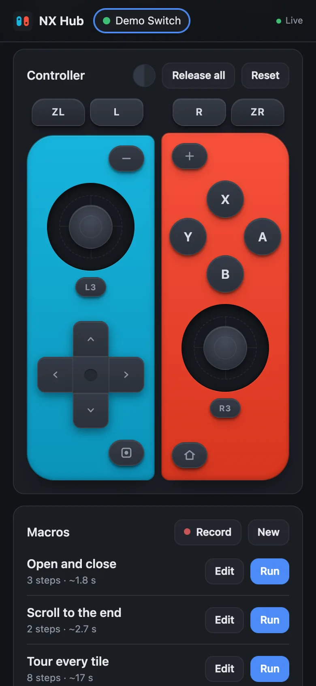
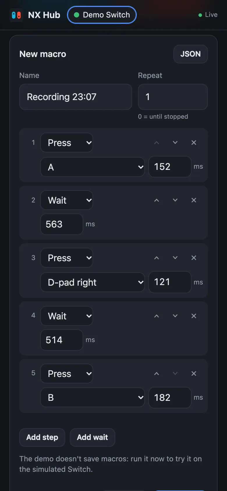

<h1 align="center">NX Hub</h1>

<p align="center">
  <strong>A self-hosted automation gateway for modded Nintendo Switch consoles, built for the Raspberry Pi.</strong><br>
  Phone-friendly controller · live view · recordable macros · REST + WebSocket API
</p>

<p align="center">
  <a href="https://mubar.uk/nx-hub/"><strong>Try the live demo →</strong></a>
  &nbsp;·&nbsp;
  <a href="docs/RASPBERRY-PI.md">Install on a Pi</a>
  &nbsp;·&nbsp;
  <a href="docs/API.md">API</a>
</p>

<p align="center">
  <a href="https://github.com/sbd1017/nx-hub/actions/workflows/ci.yml"></a>
  <a href="LICENSE"></a>
  
  
</p>

<p align="center">
  
</p>

NX Hub runs on an always-on Raspberry Pi (or any Linux, macOS or Windows machine) next to a Switch
running [sys-botbase](https://github.com/olliz0r/sys-botbase). It gives that Switch a clean, safe,
modern interface you can use from your phone, your scripts and your smart home, without ever touching
the raw sys-botbase protocol.

```text
iPhone / browser / script / Home Assistant ──► NX Hub (Pi) ──► sys-botbase ──► CFW Switch
```

NX Hub is **game-agnostic infrastructure**. It is not a trade bot and not a SysBot.NET fork.
Game-specific toolkits (Pokémon first) are planned as separate plugins.

## Features

| | |
| --- | --- |
| 🎮 **Virtual controller** | Every button and both sticks, laid out like a pair of Joy-Con. Hold-to-press on touch screens; neon or graphite. |
| 📺 **Live view** | See the Switch screen in the page (about one frame a second over Wi-Fi), so you can drive it from another room. |
| ⏺️ **Macros** | Record what you do on the controller, tweak the timings, save it, replay it. Loops, nested repeats, pause/stop. |
| 🩺 **System check** | DNS, ping, TCP, sys-botbase version and capabilities, latency, running title → **READY / DEGRADED / NOT READY**. |
| 🔌 **Connection manager** | Heartbeats, loss detection and automatic reconnect with backoff. Survives the Switch sleeping. |
| 🛡️ **Never stuck buttons** | Watchdogs and release-on-reconnect, so a dropped connection can't leave a button held down. |
| 🧩 **API first** | REST + OpenAPI 3.1 (`/docs`), live WebSocket events, RFC 9457 errors. Works from curl, Python, iOS Shortcuts, Node-RED. |
| 🍓 **Pi-first** | One self-contained arm64 package, hardened systemd service, about 80 MB of RAM. |

<p align="center">
  
  
  
</p>

Supports olliz0r **sys-botbase 2.x** and **sys-botbase-cpp 3.x**, detected automatically.

## Status

Pre-1.0 and actively developed. What has been checked on real hardware is tracked in
[docs/HARDWARE-VALIDATION.md](docs/HARDWARE-VALIDATION.md). So far:

- ✅ Installed and running on a Raspberry Pi 5 (Debian 12 Bookworm, arm64)
- ✅ Connects to a real Switch (sys-botbase 2.41): system check READY, about 50 ms latency
- ✅ Real button input: D-pad, HOME (hold) and B confirmed on the console
- ⏳ Live view and macros on real hardware: in testing
- ⏳ sys-botbase-cpp on real hardware: not yet tested

Everything else is covered by 160+ automated tests against a protocol simulator.

## Quick start

### Try it without a Switch

Needs the [.NET 10 SDK](https://dotnet.microsoft.com/download) and Node 22+.

```bash
git clone https://github.com/sbd1017/nx-hub.git && cd nx-hub
(cd web && npm ci && npm run build)
dotnet run --project src/NxHub.Simulator -- --port 6000 --interactive-screen &   # pretend Switch
dotnet run --project src/NxHub.Server                                            # http://localhost:8080
```

Open http://localhost:8080 and paste the admin token from `src/NxHub.Server/data/admin-token`.
Add a Switch with host `127.0.0.1`, port `6000`.

### On a Raspberry Pi

```bash
scripts/package.sh linux-arm64                  # on your computer
scp artifacts/nxhub-*-linux-arm64.tar.gz pi@raspberrypi.local:

tar -xzf nxhub-*-linux-arm64.tar.gz && cd nxhub-*-linux-arm64    # on the Pi
sudo ./install.sh                               # add --port 8810 if 8080 is taken
sudo cat /var/lib/nxhub/admin-token
```

Then open `http://<pi>.local:8080`. Full guide: [docs/RASPBERRY-PI.md](docs/RASPBERRY-PI.md).

**On the Switch** you need Atmosphère with sys-botbase installed, on the same network as the Pi.

## Use it from code

```bash
curl -X POST http://nxhub.local:8080/api/switches/$ID/controller/press \
  -H "Authorization: Bearer $TOKEN" -H 'Content-Type: application/json' \
  -d '{"button":"a","durationMs":100}'
```

```python
import requests

hub = requests.Session()
hub.headers["Authorization"] = "Bearer " + TOKEN
hub.post(f"{HUB}/api/switches/{ID}/macro/run", json={"macroId": "mc_skipintro1234"})
```

Interactive reference at `/docs` on your NX Hub. Guide with every endpoint and event:
[docs/API.md](docs/API.md).

## Documentation

| | |
| --- | --- |
| [ARCHITECTURE.md](docs/ARCHITECTURE.md) | Design, state machine, safety model, security, configuration |
| [API.md](docs/API.md) | REST and WebSocket guide, macros, live view |
| [RASPBERRY-PI.md](docs/RASPBERRY-PI.md) | Install and operate on a Pi 5, reverse proxy at a sub-path |
| [PROTOCOL.md](docs/PROTOCOL.md) | sys-botbase wire protocol notes and implementation differences |
| [DEVELOPMENT.md](docs/DEVELOPMENT.md) | Build, test, simulator, demo mode, packaging |
| [HARDWARE-VALIDATION.md](docs/HARDWARE-VALIDATION.md) | Checklist and results for real-hardware testing |
| [LICENSING-RESEARCH.md](docs/LICENSING-RESEARCH.md) | Upstream licences and how NX Hub stays clean |
| [HANDOVER.md](HANDOVER.md) | Current state, key decisions and next steps for maintainers |

## Roadmap

- Hardware validation of live view, macros and sys-botbase-cpp
- Scheduled macros, conditions and variables; tick-precise playback on sys-botbase-cpp
- Plugin runtime (in-process and out-of-process)
- **Pokémon trade bot** in its own repository, [nx-hub-pokemon](https://github.com/sbd1017/nx-hub-pokemon) (AGPL-3.0, built on SysBot.NET): a web queue for link trades and a trainer-info lookup, using NX Hub's hand-over API
- More Pokémon tools there later: live boxes, legality checks, Living Dex, collection manifests
- Python and TypeScript SDKs, Home Assistant integration, mDNS discovery, signed releases

## Safety and legality

NX Hub talks to homebrew on consoles you own. Custom firmware and automation carry risks, including
online bans and save corruption if memory tools are misused. NX Hub contains and downloads no
Nintendo software, keys or game data. **Never expose sys-botbase or NX Hub directly to the
internet.** Use a VPN, or an authenticating reverse proxy as described in the docs.

Not affiliated with or endorsed by Nintendo. "Nintendo Switch" and "Joy-Con" are trademarks of Nintendo.

## Contributing

Issues and pull requests are welcome. Please read [CONTRIBUTING.md](CONTRIBUTING.md), especially
the licensing rules: no code from GPL or AGPL projects.

## Licence

[Apache License 2.0](LICENSE) (see also [NOTICE](NOTICE)).
